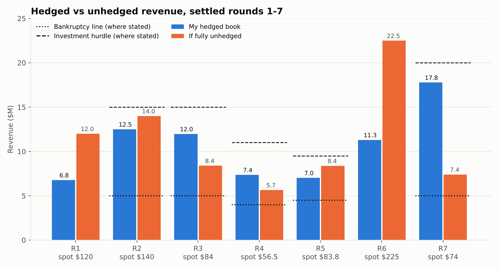
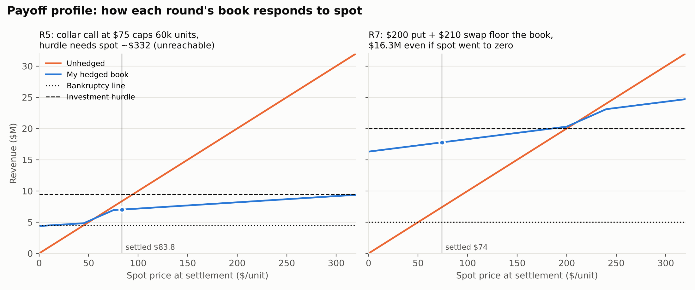
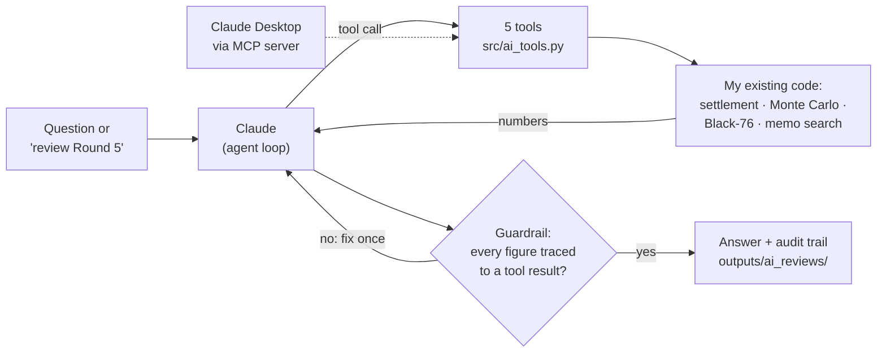

# Commodity Hedging Simulation

**Karthik Bommisetty** | UIC MBA (Finance) + MS Business Analytics
[LinkedIn](https://www.linkedin.com/in/karthik-bommisetty) · [Portfolio](https://karthikvenkata-create.github.io)

In Fall 2025 I played an eight-round hedging game at UIC as the risk manager of a producer selling 100,000 units of a commodity each round. Every week I decided how much output to lock in with fixed-price swaps, how much to protect with zero-cost collars (long put, short call), and how much to leave floating. If revenue fell below the bankruptcy line the firm took a $20M penalty, and if it cleared the investment hurdle it could fund a positive-NPV project.

This repo rebuilds the game from my original weekly decision memos and stress-tests every position I took. A Python pipeline settles all seven rounds and checks each one against the number I wrote at the time. It then prices my collars with Black-76, runs each round's book through 10,000 simulated settlement prices, and exports everything to a multi-tab Excel audit report.

On top of the pipeline sits an **AI treasury analyst built on the Claude API**. It reviews each round the way a risk desk would: it pulls my position, quotes my reasoning from the original memo, stress-tests the book, and picks and tests its own alternative hedges, with every number coming from my code rather than the model. [More below](#ai-treasury-analyst-claude).

**[Download the audit report](outputs/hedging_audit_report.xlsx)**: Summary, Assumptions, Settlement, Collar Pricing, Stress Test, Vol Sensitivity.
**[Read the AI's round-by-round reviews](outputs/ai_reviews/)**.

## What actually happened



Over the seven settled rounds my hedged book earned $74.70M against $78.33M if I had stayed fully unhedged. Hedging cost $3.63M, about 4.6% of revenue, and cut round-to-round revenue volatility by about 30%. The best round was Round 7: spot crashed from $225 to $74, and the hedges delivered $17.78M against $7.40M unhedged. None of the rounds with a stated hurdle cleared it, hedged or unhedged.

Looking only at these results, the unhedged book never crossed a bankruptcy line either, so it is tempting to say the hedge was protecting against nothing. The stress test shows that conclusion is hindsight.

## What the stress test shows

**Volatility comes from the game itself.** Round-to-round log changes in the settled spot have a standard deviation of 74% per round. Each round's position is run through 10,000 lognormal settlement prices centered on the forward (the round's swap price) at that volatility, with a fixed seed.

**The bankruptcy risk was real.** Before each trade, staying unhedged carried a 6% to 52% chance of landing below the bankruptcy line, about 25% on average across the five rounds with a stated line. My hedges took that to about 1%. The realized prices just happened to miss the line.

**The price was the investment.** The same hedges lowered the chance of funding the project from 26% to 18% on average. In Round 5 it fell from 14% to under 1%, because a $75 collar call on 60,000 units capped revenue below the hurdle. Round 7 was the only round where hedging raised the odds (38% to 43%), because its $200 put and $210 swap sat right at the hurdle price.

**The game's collars were not all fair.** Black-76 pricing of my three collars shows the free collar in Round 5 was worth about $67K less than a fair zero-cost collar, while Rounds 6 and 7 gave me about $111K and $165K of free value. In Round 7, a truly zero-cost call against the $200 put would sit near $229 at the game's volatility, not $240.

**The result holds across volatilities.** The Vol Sensitivity tab re-runs everything from 20% to 95% volatility. Hedging cuts 95% VaR in every round at every level, and the hurdle tradeoff stays negative for Rounds 2 to 5 throughout.



## Takeaways

At the volatility this game actually had, the hedges were doing real work: they turned a one-in-four chance of a $20M penalty into roughly one in a hundred. What I got wrong was the other side of the ledger. My strikes and sizing gave away the upside the firm needed to fund the investment, in every round but the last. Strike placement mattered more than hedge ratio. If I played again, I would set collar calls at or above the hurdle price, so the upside I give up is upside the firm doesn't need, and I would size each round from the bankruptcy and hurdle probabilities instead of defaulting to 60 to 70% hedged.

## AI treasury analyst (Claude)

On top of the pipeline sits an AI analyst built on the Claude API. You ask it a question in plain English, like *"what if I had put the Round 5 collar call at $95 instead of $75?"*, and Claude works out which of my functions to run, runs them, and writes up the answer. The math never happens inside the model. Every number comes from the same settlement, Monte Carlo and Black-76 code the tests and the Excel report use.



Here is a real run. I asked whether the $75 call I sold in Round 5 was a mistake. Claude made seven tool calls on its own:

```
python src/ai_analyst.py ask 'Was the $75 call in Round 5 a mistake?' --save
  -> get_round({"round": 5})
  -> memo_search({"query": "collar call strike 75", "round": 5, "top_k": 8})
  -> evaluate_hedge({"round": 5})
  -> evaluate_hedge({"round": 5, "call_strike": 95})
  -> evaluate_hedge({"round": 5, "collar_qty": 30000})
  -> evaluate_hedge({"round": 5, "collar_qty": 30000, "call_strike": 95})
  -> price_collar({"round": 5, "put_strike": 45, "call_strike": 75})
```

and concluded (excerpt, [full answer and audit trail](outputs/ai_transcripts/20261027-1356_was-the-75-call-in-round-5-a-mistake.md)):

> **Short answer:** No, not a clear mistake. The $75 call cost Karthik $528K in hindsight, but the stress test shows it was a small decision. Its real weakness was that it gave up slightly more than it received.
>
> At fair value this collar [with a $95 call] was worth $145K to the hedger, which is $212K more than his actual collar. After paying that, expected revenue was only $1.7K above his actual book. [...] This is roughly a wash once priced fairly.

**What the reviews found** ([all seven](outputs/ai_reviews/)):

- **Round 7:** the 20,000 units I left floating were the real gap. Hedging them too would have put a $20.5M floor under revenue and a 100% chance of clearing the $20M hurdle, for $22K less expected revenue.
- **Round 5:** raising the collar call from $75 to $95 looks like +$214K of expected revenue if the new collar is free, but about +$2K once it is paid for at fair value.
- **Round 4:** my decision memo sized the hedge against a "$5M minimum", but my own result memo for that round lists the bankruptcy line as $4M. The hedge was still sound either way.
- **Rounds 2 to 4:** each hedge removed the bankruptcy risk, but none of my memos weighed the investment hurdle, and the hedge cut the chance of clearing it by about 10 points each time.

**What it's built from**

- **Tool use.** Claude gets five tools: `get_round`, `portfolio_summary`, `evaluate_hedge` (settle and stress-test any alternative book), `price_collar` (Black-76) and `memo_search`. Each is a thin wrapper in [`src/ai_tools.py`](src/ai_tools.py) around code that was already here. Bad inputs, like a put strike above the call, go back to Claude as an error message so it can fix the call.
- **Agent loop.** [`src/ai_analyst.py`](src/ai_analyst.py) sends the question, runs whatever tools Claude asks for, sends the results back, and repeats until it has an answer. `review` mode has it go through a round on its own: pull my position, find my reasoning in the memo, stress-test the book, then pick and test up to three alternatives, each for a stated reason. The tools enforce the game's rules (no collars before Round 5), and from Round 5 on they price any new collar at Black-76 fair value, since the game handed every collar out for free.
- **RAG over my decision memos.** The eight memos I wrote during the game are in [`memos/`](memos/). [`src/memo_search.py`](src/memo_search.py) splits them into sections and ranks them with BM25, so the analyst quotes what I actually wrote at the time instead of guessing at my reasoning.
- **Guardrail.** After every answer, each dollar figure and percentage is checked against the numbers the tools returned, at the precision it was written ($7.0M has to be within $50K of a real number). Anything that doesn't trace back is sent to Claude once to fix; if it's still there, the answer prints with a warning. Saved answers end with an audit trail of every tool call.
- **MCP server.** [`src/mcp_server.py`](src/mcp_server.py) exposes the same five tools over the Model Context Protocol, so Claude Desktop can use the hedging engine directly.

The AI layer has its own tests (`tests/test_ai.py`) that run without an API key: the tools have to agree with the engine to the dollar, the memo search has to find the right section, and the agent loop is played through a fake client to check that tool errors and the guardrail behave.

## How it works

```
data/rounds.csv          positions, strikes, settled spot and stated lines, from each memo
src/hedge_engine.py      settlement, memo check, headline metrics
src/pricing.py           Black-76 price, delta, gamma; zero-cost call solver (scipy brentq)
src/stress_test.py       10,000-scenario Monte Carlo per round, VaR / ES / probabilities, vol sensitivity
src/excel_report.py      builds outputs/hedging_audit_report.xlsx with openpyxl
src/charts.py            the two charts above
tests/test_engine.py     memo reconciliation, put-call parity, solver, Greeks vs finite differences

memos/                   my eight decision memos, Oct 13 to Dec 2, 2025
src/ai_tools.py          the five tools Claude can call, and their schemas
src/memo_search.py       BM25 search over the memos
src/ai_analyst.py        agent loop, guardrail, ask / review / chat commands
src/mcp_server.py        the same tools as an MCP server
tests/test_ai.py         tools vs engine, memo search, agent loop with a fake client
```

The Settlement and Collar Pricing tabs are live Excel formulas, not pasted values. Change a strike or the risk-free rate and the workbook recomputes. The zero-cost call strikes are solved in Python and then repriced in Excel, so a reviewer can see the solver's answer checked by an independent formula. Blue cells are inputs, black are formulas, and green are links between tabs.

Settlement rule for each round:

```
revenue = 100,000 x spot + swap_qty x (swap - spot)
        + collar_qty x [max(put - spot, 0) - max(spot - call, 0)]
```

## Run it

```
pip install -r requirements.txt
python src/hedge_engine.py     # settlement + checks
python src/stress_test.py      # Monte Carlo summary in the terminal
python src/excel_report.py     # writes outputs/hedging_audit_report.xlsx
python src/charts.py
pytest -q
```

To use the AI analyst (Python 3.10+), copy `.env.example` to `.env` and put your Anthropic API key in it. `.env` is in `.gitignore`, so the key never gets committed. A question costs a few cents.

```
python src/ai_analyst.py ask "What if I had hedged only 40% in Round 4?" --save
python src/ai_analyst.py review --round 5     # writes outputs/ai_reviews/round_5.md
python src/ai_analyst.py review --all
python src/ai_analyst.py chat
```

To use the tools from Claude Desktop instead, add this to its config (Settings > Developer > Edit Config) with your own paths, then restart it:

```json
{
  "mcpServers": {
    "hedging-analyst": {
      "command": "/path/to/python3",
      "args": ["/path/to/Commodity-Hedging-Simulation/src/mcp_server.py"]
    }
  }
}
```

## Notes on the data and model

The inputs come from my eight decision memos (Oct 13 to Dec 2, 2025), one per week; the original Google Docs keep their 2025 version history. Round 8 was the wrap-up period, so seven rounds settled. Bankruptcy lines and hurdles were not stated in my Round 1 and Round 6 memos, so those rounds are left out of the bankruptcy and hurdle checks.

The forward for each round is taken as that round's swap price. Settlement prices are simulated as lognormal with mean equal to the forward, which is the risk-neutral view; real-world drift would shift the probabilities. Volatility is estimated from only six price changes, which is why the Vol Sensitivity tab exists. The risk-free rate (4%) only discounts option premiums and barely moves the results.
